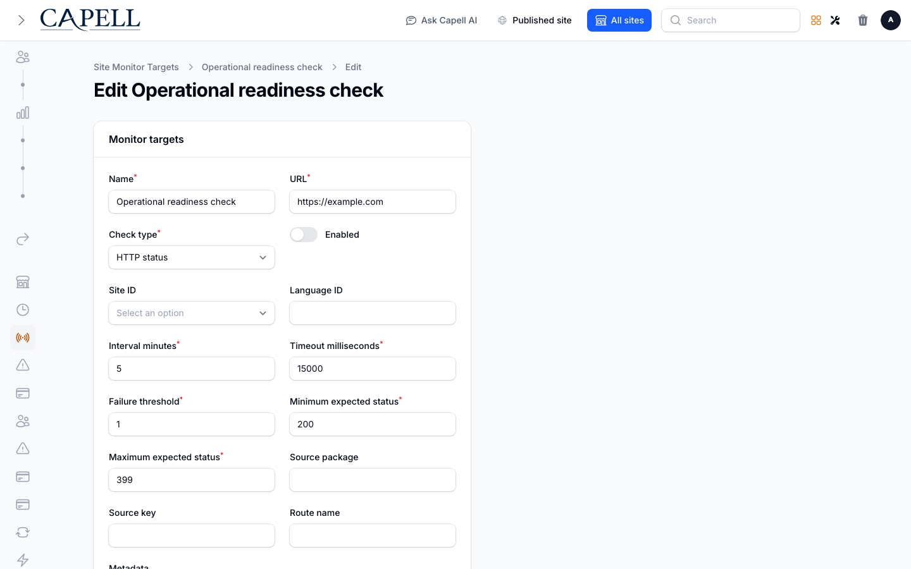
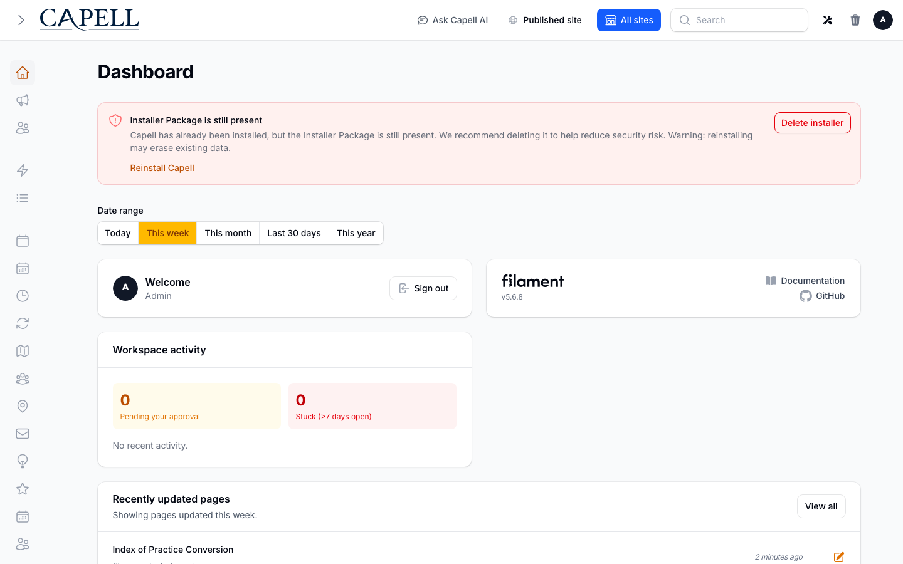

# Site Monitor

<!-- prettier-ignore-start -->

## What This Plugin Adds

Site Monitor is an **Available**, **Schema-owning** Capell package in the **Capell Operations** product group. It ships as `capell-app/site-monitor` and extends these surfaces: admin, console, shared.

Site Monitor records HTTP availability, certificate expiry, domain expiry and incidents inside Capell admin, with checks running from your application host. It is a free first-party package with Stable maturity. Check the release catalogue for the verification and availability of the version you plan to install.

The package supplies a health dashboard, target and incident resources, scheduled checks and queue jobs. Installation requires current release evidence and host verification; configure the scheduler, queue worker and notification integration before relying on its alerts.

Status details:

- Status: Available
- Tier: free
- Bundle: operations
- Composer package: `capell-app/site-monitor`
- Namespace: `Capell\SiteMonitor`
- Theme key: not applicable

## Why It Matters

**For developers:** Run checks outside the public render path, inspect typed results, connect incident events to your alerting system and retain operator-owned target settings during automatic discovery.

**For teams:** Review failing targets and expiry warnings alongside other site operations. A check runs from your application host, not an independent monitoring network; retain independent monitoring for outages that also stop that host.

## Screens And Workflow

Screenshot contract: `docs/screenshots.json`.

- Site Monitor extension card (marketplace, supplementary documentation fixture).
- Site Monitor dashboard (admin, supplementary documentation fixture).
- Site Monitor incident detail (admin, supplementary documentation fixture).
- Site Monitor target form (admin, required evidence).
- Site Monitor targets index (admin, supplementary evidence).
- Site Monitor incident resolution form (admin, supplementary evidence).
- Site Monitor dashboard with admin sidebar menu open (admin, supplementary evidence).

## Technical Shape

### Service providers

- `Capell\SiteMonitor\Providers\SiteMonitorServiceProvider`
- `Capell\SiteMonitor\Providers\AdminServiceProvider`

### Config files

- `packages/site-monitor/config/capell-site-monitor.php`

### Migrations

- `packages/site-monitor/database/migrations/2026_06_13_000001_create_site_monitor_targets_table.php`
- `packages/site-monitor/database/migrations/2026_06_13_000002_create_site_monitor_runs_table.php`
- `packages/site-monitor/database/migrations/2026_06_13_000003_create_site_monitor_incidents_table.php`
- `packages/site-monitor/database/migrations/2026_10_04_000001_remove_implicit_timestamp_updates_from_site_monitor.php`

### Models

- `SiteMonitorIncident`
- `SiteMonitorRun`
- `SiteMonitorTarget`

### Filament classes

- `SiteMonitorDashboardPage`
- `EditSiteMonitorIncident`
- `ListSiteMonitorIncidents`
- `SiteMonitorIncidentResource`
- `CreateSiteMonitorTarget`
- `EditSiteMonitorTarget`
- `ListSiteMonitorTargets`
- `SiteMonitorTargetResource`

### Policies

- `AbstractSiteMonitorResourcePolicy`
- `SiteMonitorIncidentPolicy`
- `SiteMonitorTargetPolicy`

### Extension contracts

- `SiteMonitorDomainExpiryClient`
- `SiteMonitorHostResolver`
- `SiteMonitorHttpClient`

### Events

- `SiteMonitorIncidentOpened`
- `SiteMonitorIncidentResolved`

### Actions

- `AuthoriseSiteMonitorTargetSiteAction`
- `BuildSiteMonitorDashboardAction`
- `GuardSiteMonitorOutboundUrlAction`
- `PrepareSiteMonitorScreenshotAction`
- `PruneSiteMonitorRunsAction`
- `QueueSiteMonitorTargetCheckAction`
- `ReconcileSiteMonitorIncidentAction`
- `RecordSiteMonitorRunAction`
- `ResolveRdapEndpointAction`
- `ResolveSiteMonitorSocketAddressAction`
- `ResolveSiteMonitorTargetsAction`
- `RunDueSiteMonitorChecksAction`
- `RunSiteMonitorCheckAction`

### Data objects

- `SiteMonitorCheckResultData`
- `SiteMonitorDashboardData`
- `SiteMonitorIncidentData`
- `SiteMonitorTargetData`

### Jobs

- `RunSiteMonitorTargetJob`

### Command signatures

- `capell:site-monitor:doctor`
- `capell:site-monitor:run`

### Manifest action API

- `buildSiteMonitorDashboard: Capell\SiteMonitor\Actions\BuildSiteMonitorDashboardAction`
- `reconcileSiteMonitorIncident: Capell\SiteMonitor\Actions\ReconcileSiteMonitorIncidentAction`
- `recordSiteMonitorRun: Capell\SiteMonitor\Actions\RecordSiteMonitorRunAction`
- `resolveSiteMonitorTargets: Capell\SiteMonitor\Actions\ResolveSiteMonitorTargetsAction`
- `runDueSiteMonitorChecks: Capell\SiteMonitor\Actions\RunDueSiteMonitorChecksAction`
- `runSiteMonitorCheck: Capell\SiteMonitor\Actions\RunSiteMonitorCheckAction`

### Scheduled commands

- `capell:site-monitor:run (everyMinute; package registered)`

### Console command classes

- `RunSiteMonitorCommand`
- `SiteMonitorDoctorCommand`

### Manifest contributions

- `admin-page: Capell\SiteMonitor\Manifest\SiteMonitorDashboardPageContribution`
- `admin-resource: Capell\SiteMonitor\Manifest\SiteMonitorIncidentResourceContribution`
- `admin-resource: Capell\SiteMonitor\Manifest\SiteMonitorTargetResourceContribution`
- `console-command: Capell\SiteMonitor\Manifest\SiteMonitorConsoleCommandsContribution`
- `health-check: Capell\SiteMonitor\Manifest\SiteMonitorHealthContribution`
- `migration: Capell\SiteMonitor\Manifest\SiteMonitorMigrationsContribution`
- `model: Capell\SiteMonitor\Manifest\SiteMonitorIncidentModelContribution`
- `model: Capell\SiteMonitor\Manifest\SiteMonitorRunModelContribution`
- `model: Capell\SiteMonitor\Manifest\SiteMonitorTargetModelContribution`
- `scheduled-job: Capell\SiteMonitor\Manifest\SiteMonitorScheduledChecksContribution`

### Health checks

- `Capell\SiteMonitor\Health\SiteMonitorHealthCheck`

### Blade views

- `packages/site-monitor/resources/views/filament/pages/site-monitor-dashboard.blade.php`

### Cache tags

- `site-monitor`

## Data Model

- Required tables: `site_monitor_targets`, `site_monitor_runs`, `site_monitor_incidents`.
- Models: `SiteMonitorIncident`, `SiteMonitorRun`, `SiteMonitorTarget`.
- Core record references in migrations: `sites via site_id`, `languages via language_id`.
- Migration files: `2026_06_13_000001_create_site_monitor_targets_table.php`, `2026_06_13_000002_create_site_monitor_runs_table.php`, `2026_06_13_000003_create_site_monitor_incidents_table.php`, `2026_10_04_000001_remove_implicit_timestamp_updates_from_site_monitor.php`.
- Migration impact: run host migrations through the package install flow before opening package surfaces.
- Deletion/retention behaviour: migrations declare cascade-on-delete relationships and null-on-delete relationships; no timed pruning or retention schedule is declared in `capell.json`.

## Install Impact

- Required packages: `capell-app/admin`, `capell-app/core`, `capell-app/discovery-foundation`, `capell-app/frontend`.
- Admin navigation: declares `admin-page: SiteMonitorDashboardPageContribution`, `admin-resource: SiteMonitorIncidentResourceContribution`, `admin-resource: SiteMonitorTargetResourceContribution`; each Filament page or resource controls its own navigation visibility.
- Admin/editor extensions: none declared.
- Permissions: `View:SiteMonitorTarget`, `Create:SiteMonitorTarget`, `Update:SiteMonitorTarget`, `Delete:SiteMonitorTarget`, `View:SiteMonitorIncident`, `Update:SiteMonitorIncident`; access also governed by package policies: `AbstractSiteMonitorResourcePolicy`, `SiteMonitorIncidentPolicy`, `SiteMonitorTargetPolicy`.
- Public routes: none declared.
- Database changes: package migrations are declared.
- Config: `config/capell-site-monitor.php`.
- Settings: no package settings declared.
- Queues or schedules: scheduled commands `capell:site-monitor:run (everyMinute; package registered)`; queue jobs `RunSiteMonitorTargetJob`.
- Cache tags: `site-monitor`.
- Commands: `capell:site-monitor:doctor`, `capell:site-monitor:run`.

## Common Pitfalls

- Keep required Capell packages on compatible v4 releases: `capell-app/admin`, `capell-app/core`, `capell-app/discovery-foundation`, `capell-app/frontend`.
- Run migrations before opening package resources or public routes.
- Review package configuration before production-like verification: `config/capell-site-monitor.php`.
- Keep the host Laravel scheduler running so package-registered schedules can execute: `capell:site-monitor:run (everyMinute; package registered)`.
- Custom write integrations must preserve invalidation for `site-monitor` cache tags.

## Troubleshooting

| Symptom | Likely cause | Check | Fix |
| --- | --- | --- | --- |
| Package health check reports a problem | Package configuration or runtime dependencies are not ready | Run `php artisan capell:site-monitor:doctor` | Follow the reported checks, then rerun the doctor command |
| Package surface is missing after install | Provider or manifest is not loaded | Confirm `capell.json`, package `composer.json`, and provider registration | Reinstall the package, refresh Composer autoload, and clear host caches |
| Admin screen or command fails on missing table | Package migrations have not run | Check the tables listed in `Data Model` | Run host migrations and rerun the focused package test |
| Background work does not run | Queue worker or declared schedule is not active | Check the jobs and scheduled commands listed in `Technical Shape` | Start the queue worker or host scheduler, then run the focused command or package test |

## Quick Start

1. Install the package: `composer require capell-app/site-monitor`.
2. Open the package admin page or resource and verify Site Monitor is available.

## Next Steps

- [Package docs](docs/README.md)
- [Overview](docs/overview.md)
- [Worked extension examples](docs/extension-contracts.md)
- [Admin guide](docs/admin-guide.md)
- Configuration files: [`config/capell-site-monitor.php`](config/capell-site-monitor.php).
- [Troubleshooting](#troubleshooting)
- [Screenshot contract](docs/screenshots.json)
- [Marketplace assets](docs/assets/marketplace/)
- [Capell content language plan](../../docs/CONTENT_LANGUAGE_PLAN.md)
- [Capell documentation design system](../../docs/DESIGN_SYSTEM.md)
- [Capell and package ERD notes](../../docs/erd/capell-and-package-erds.md)
- Related packages: [Discovery Foundation](../discovery-foundation/README.md), [Diagnostics](../diagnostics/README.md), [Email Studio](../email-studio/README.md), [Exception Reports](../exception-reports/README.md), [Seo Suite](../seo-suite/README.md), [Site Discovery](../site-discovery/README.md), [Url Manager](../url-manager/README.md).

<!-- prettier-ignore-end -->
