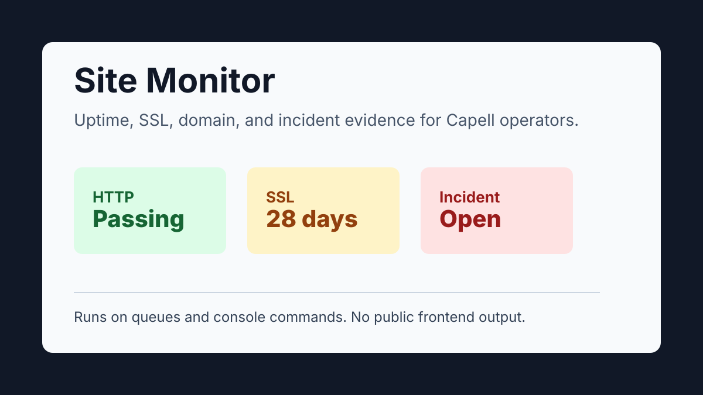

# Site Monitor

<!-- prettier-ignore-start -->

## What This Plugin Adds

Site Monitor is a **Pipeline**, **Schema-owning** Capell package in the **Capell Operations** product group. It is tracked as `capell-app/site-monitor` and plans these surfaces: admin, console, shared.

Site Monitor is a Pipeline package for planned external uptime, SSL certificate, domain-expiry, and incident monitoring.

It is not supported as an installed operator surface yet. Its dashboard, resources, commands, schedule, and schema remain review-required until certification and host-install verification are complete.

Evidence: [`capell.json`](capell.json), [`src/Enums/SiteMonitorCheckType.php`](src/Enums/SiteMonitorCheckType.php), [`src/Actions/RunSiteMonitorCheckAction.php`](src/Actions/RunSiteMonitorCheckAction.php), [`src/Manifest/SiteMonitorDashboardPageContribution.php`](src/Manifest/SiteMonitorDashboardPageContribution.php), [`src/Manifest/SiteMonitorScheduledChecksContribution.php`](src/Manifest/SiteMonitorScheduledChecksContribution.php), [`tests/Unit/ManifestRequirementsTest.php`](tests/Unit/ManifestRequirementsTest.php).

Status details:

- Status: Pipeline
- Tier: premium
- Bundle: operations
- Composer package: `capell-app/site-monitor`
- Namespace: `Capell\SiteMonitor`
- Theme key: not applicable

## Why It Matters

**For developers:** The review scaffold contains typed check Actions, an outbound-URL guard, queued target jobs, models, and manifest contributions for certification work.

**For teams:** Teams should not depend on this package in production yet. Its intended outcome is one place to review external checks and incidents after certification is complete.

Evidence: [`src/Actions/GuardSiteMonitorOutboundUrlAction.php`](src/Actions/GuardSiteMonitorOutboundUrlAction.php), [`src/Actions/RunSiteMonitorCheckAction.php`](src/Actions/RunSiteMonitorCheckAction.php), [`src/Jobs/RunSiteMonitorTargetJob.php`](src/Jobs/RunSiteMonitorTargetJob.php), [`tests/Feature/RunSiteMonitorCheckActionTest.php`](tests/Feature/RunSiteMonitorCheckActionTest.php), [`capell.json`](capell.json), [`src/Actions/BuildSiteMonitorDashboardAction.php`](src/Actions/BuildSiteMonitorDashboardAction.php), [`tests/Feature/Admin/SiteMonitorAdminSurfaceTest.php`](tests/Feature/Admin/SiteMonitorAdminSurfaceTest.php).

## Screens And Workflow

Screenshot contract: `docs/screenshots.json`.

- Site Monitor extension card (marketplace, required).
- Site Monitor dashboard and incident previews remain diagnostic-only until authenticated package fixtures have matching runner receipts.
- Site Monitor target form (admin, optional).
- Site Monitor check history (admin, optional).
- Site Monitor targets index (admin, optional).
- Site Monitor incident resolution form (admin, optional).

## Technical Shape

- Service providers: `Capell\SiteMonitor\Providers\SiteMonitorServiceProvider`, `Capell\SiteMonitor\Providers\AdminServiceProvider`.
- Config files: `packages/site-monitor/config/capell-site-monitor.php`.
- Migrations: `packages/site-monitor/database/migrations/2026_06_13_000001_create_site_monitor_targets_table.php`, `packages/site-monitor/database/migrations/2026_06_13_000002_create_site_monitor_runs_table.php`, `packages/site-monitor/database/migrations/2026_06_13_000003_create_site_monitor_incidents_table.php`.
- Models: `SiteMonitorIncident`, `SiteMonitorRun`, `SiteMonitorTarget`.
- Filament classes: `SiteMonitorDashboardPage`, `EditSiteMonitorIncident`, `ListSiteMonitorIncidents`, `SiteMonitorIncidentResource`, `CreateSiteMonitorTarget`, `EditSiteMonitorTarget`, `ListSiteMonitorTargets`, `SiteMonitorTargetResource`.
- Policies: `AbstractSiteMonitorResourcePolicy`, `SiteMonitorIncidentPolicy`, `SiteMonitorTargetPolicy`.
- Extension contracts: `SiteMonitorDomainExpiryClient`, `SiteMonitorHttpClient`.
- Events: `SiteMonitorIncidentOpened`, `SiteMonitorIncidentResolved`.
- Actions: `BuildSiteMonitorDashboardAction`, `GuardSiteMonitorOutboundUrlAction`, `PruneSiteMonitorRunsAction`, `ReconcileSiteMonitorIncidentAction`, `RecordSiteMonitorRunAction`, `ResolveRdapEndpointAction`, `ResolveSiteMonitorTargetsAction`, `RunDueSiteMonitorChecksAction`, `RunSiteMonitorCheckAction`.
- Data objects: `SiteMonitorCheckResultData`, `SiteMonitorDashboardData`, `SiteMonitorIncidentData`, `SiteMonitorTargetData`.
- Jobs: `RunSiteMonitorTargetJob`.
- Command signatures: `capell:site-monitor:doctor`, `capell:site-monitor:run`.
- Manifest action API: `buildSiteMonitorDashboard: Capell\SiteMonitor\Actions\BuildSiteMonitorDashboardAction`, `reconcileSiteMonitorIncident: Capell\SiteMonitor\Actions\ReconcileSiteMonitorIncidentAction`, `recordSiteMonitorRun: Capell\SiteMonitor\Actions\RecordSiteMonitorRunAction`, `resolveSiteMonitorTargets: Capell\SiteMonitor\Actions\ResolveSiteMonitorTargetsAction`, `runDueSiteMonitorChecks: Capell\SiteMonitor\Actions\RunDueSiteMonitorChecksAction`, `runSiteMonitorCheck: Capell\SiteMonitor\Actions\RunSiteMonitorCheckAction`.
- Scheduled commands: `capell:site-monitor:run (everyMinute)`.
- Console command classes: `RunSiteMonitorCommand`, `SiteMonitorDoctorCommand`.
- Manifest contributions: `admin-page: Capell\SiteMonitor\Manifest\SiteMonitorDashboardPageContribution`, `admin-resource: Capell\SiteMonitor\Manifest\SiteMonitorIncidentResourceContribution`, `admin-resource: Capell\SiteMonitor\Manifest\SiteMonitorTargetResourceContribution`, `console-command: Capell\SiteMonitor\Manifest\SiteMonitorConsoleCommandsContribution`, `health-check: Capell\SiteMonitor\Manifest\SiteMonitorHealthContribution`, `model: Capell\SiteMonitor\Manifest\SiteMonitorIncidentModelContribution`, `model: Capell\SiteMonitor\Manifest\SiteMonitorRunModelContribution`, `model: Capell\SiteMonitor\Manifest\SiteMonitorTargetModelContribution`, `scheduled-job: Capell\SiteMonitor\Manifest\SiteMonitorScheduledChecksContribution`.
- Health checks: `Capell\SiteMonitor\Health\SiteMonitorHealthCheck`.
- Blade views: `packages/site-monitor/resources/views/filament/pages/site-monitor-dashboard.blade.php`.
- Cache tags: `site-monitor`.

## Data Model

- Required tables: `site_monitor_targets`, `site_monitor_runs`, `site_monitor_incidents`.
- Models: `SiteMonitorIncident`, `SiteMonitorRun`, `SiteMonitorTarget`.
- Core record references in migrations: `sites via site_id`, `languages via language_id`.
- Migration files: `2026_06_13_000001_create_site_monitor_targets_table.php`, `2026_06_13_000002_create_site_monitor_runs_table.php`, `2026_06_13_000003_create_site_monitor_incidents_table.php`.
- Migration impact: review required; migration files exist and must be verified through the host install flow.
- Deletion/retention behaviour: migrations declare cascade-on-delete relationships and null-on-delete relationships; no timed pruning or retention schedule is declared in `capell.json`.

## Install Impact

- Availability: Pipeline; review required before installing in a host Capell app.
- Required packages: `capell-app/admin`, `capell-app/core`, `capell-app/frontend`.
- Admin navigation: declares `admin-page: SiteMonitorDashboardPageContribution`, `admin-resource: SiteMonitorIncidentResourceContribution`, `admin-resource: SiteMonitorTargetResourceContribution`; each Filament page or resource controls its own navigation visibility.
- Admin/editor extensions: none declared.
- Permissions: `View:SiteMonitorTarget`, `Create:SiteMonitorTarget`, `Update:SiteMonitorTarget`, `Delete:SiteMonitorTarget`, `View:SiteMonitorIncident`, `Update:SiteMonitorIncident`.
- Public routes: none declared.
- Database changes: package migrations are declared.
- Config: `config/capell-site-monitor.php`.
- Settings: no package settings declared.
- Queues or schedules: scheduled commands `capell:site-monitor:run (everyMinute)`; queue jobs `RunSiteMonitorTargetJob`.
- Cache tags: `site-monitor`.
- Commands: `capell:site-monitor:doctor`, `capell:site-monitor:run`.

## Common Pitfalls

- Do not describe review-required providers, routes, migrations, commands, or admin resources as shipped install behaviour.
- Keep class references out of `capell.json` until those classes exist and focused tests pass.
- Keep screenshot and workflow notes labelled as review-required until real package screens are captured or verified.

## Troubleshooting

| Symptom | Likely cause | Check | Fix |
| --- | --- | --- | --- |
| Package tests fail before assertions | Manifest or provider metadata references classes that do not exist yet | Check `capell.json`, package `composer.json`, and provider imports | Remove planned class references or add the classes and focused tests before marking the package Available |
| Docs describe installable behaviour | Pipeline docs drifted into shipped-language claims | Check `status`, `Install Impact`, and `Quick Start` | Keep the package labelled Pipeline until the install flow is verified |

## Quick Start

1. Review `capell.json`, package docs, and any scaffolded source before treating the package as installable.
2. Complete certification review, host install verification, migrations, and admin surface checks.
3. Run the docs checks, focused package tests, and install verification before changing the status from Pipeline to Available.

## Next Steps

- [Package docs](docs/README.md)
- [Overview](docs/overview.md)
- [Admin guide](docs/admin-guide.md)
- Configuration files: [`config/capell-site-monitor.php`](config/capell-site-monitor.php).
- [Troubleshooting](#troubleshooting)
- [Screenshot contract](docs/screenshots.json)
- [Marketplace assets](docs/assets/marketplace/)
- [Capell content language plan](../../docs/CONTENT_LANGUAGE_PLAN.md)
- [Capell documentation design system](../../docs/DESIGN_SYSTEM.md)
- [Capell and package ERD notes](../../docs/erd/capell-and-package-erds.md)
- Related packages: [Diagnostics](../diagnostics/README.md), [Email Studio](../email-studio/README.md), [Exception Reports](../exception-reports/README.md), [Seo Suite](../seo-suite/README.md), [Site Discovery](../site-discovery/README.md), [Url Manager](../url-manager/README.md).
- Docs gap: finish certification review and host install verification before marking this package Available.

<!-- prettier-ignore-end -->
