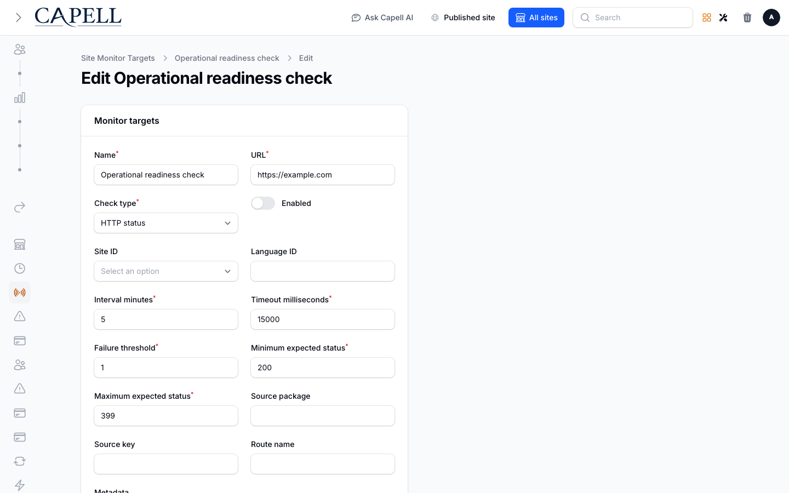
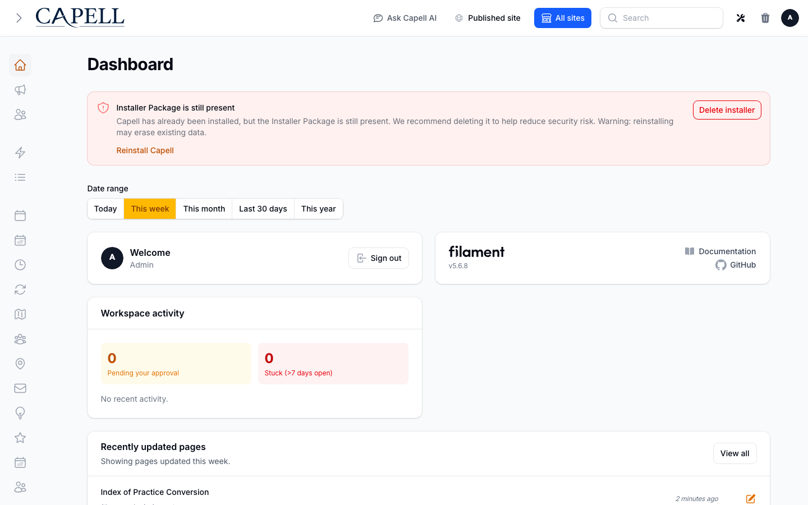

# Site Monitor

<!-- prettier-ignore-start -->

## What It Does

Site Monitor records HTTP availability, certificate expiry, domain expiry and incidents inside Capell admin, with checks running from your application host. It is a free first-party package with Stable maturity. Check the release catalogue for the verification and availability of the version you plan to install.

- **Price and availability:** Check current availability and price on the [Capell Marketplace listing](https://capell.app/extensions/site-monitor).
- **Licence:** Check the licence terms on the [Capell Marketplace listing](https://capell.app/extensions/site-monitor).
- **Requires:** `PHP ^8.4`, `capell-app/admin ^1.0.71`, `capell-app/core ^1.0.76`, `capell-app/discovery-foundation ^1.0`, `capell-app/frontend ^1.0`, `filament/filament ^5.7.6`, `filament/support ^5.7.6`, `laravel/framework ^12.61.1|^13.12.0`, `lorisleiva/laravel-actions ^2.8`, `spatie/laravel-data ^4.5`, `spatie/laravel-package-tools ^1.14.1`.
- **Install:** `composer require capell-app/site-monitor`.

The package supplies a health dashboard, target and incident resources, scheduled checks and queue jobs. Installation requires current release evidence and host verification; configure the scheduler, queue worker and notification integration before relying on its alerts.

## Who It Is For

**For developers:** Run checks outside the public render path, inspect typed results, connect incident events to your alerting system and retain operator-owned target settings during automatic discovery.

**For teams:** Review failing targets and expiry warnings alongside other site operations. A check runs from your application host, not an independent monitoring network; retain independent monitoring for outages that also stop that host.

## Quick Start

1. Install the package: `composer require capell-app/site-monitor`.
2. Open the package admin page or resource and verify Site Monitor is available.

## Configure

- **Configuration files:** `config/capell-site-monitor.php`.
- **Commands:** `php artisan capell:site-monitor-screenshot-fixture`, `php artisan capell:site-monitor:doctor`, `php artisan capell:site-monitor:run`.

## Limits And Pitfalls

- Install the required Capell packages at the versions in `composer.json`: `capell-app/admin ^1.0.71`, `capell-app/core ^1.0.76`, `capell-app/discovery-foundation ^1.0`, `capell-app/frontend ^1.0`.
- Run migrations before opening package resources or public routes.
- Keep the host Laravel scheduler running so package-registered schedules can execute: `capell:site-monitor:run (everyMinute; package registered)`.
- Custom write integrations must preserve invalidation for `site-monitor` cache tags.

## Screens And Workflow

- Site Monitor extension card (marketplace).
- Site Monitor dashboard (admin).
- Site Monitor incident detail (admin).
- Site Monitor target form (admin).
- Site Monitor targets index (admin).
- Site Monitor incident resolution form (admin).
- Site Monitor dashboard with admin sidebar menu open (admin).

## Install Impact

- Required packages: `capell-app/admin`, `capell-app/core`, `capell-app/discovery-foundation`, `capell-app/frontend`.
- Admin navigation: declares `admin-page: SiteMonitorDashboardPageContribution`, `admin-resource: SiteMonitorIncidentResourceContribution`, `admin-resource: SiteMonitorTargetResourceContribution`; each Filament page or resource controls its own navigation visibility.
- Admin/editor extensions: none declared.
- Permissions: `View:SiteMonitorTarget`, `Create:SiteMonitorTarget`, `Update:SiteMonitorTarget`, `Delete:SiteMonitorTarget`, `View:SiteMonitorIncident`, `Update:SiteMonitorIncident`; access also governed by package policies: `AbstractSiteMonitorResourcePolicy`, `SiteMonitorIncidentPolicy`, `SiteMonitorTargetPolicy`.
- Public routes: none declared.
- Database changes: package migrations are declared.
- Config: `config/capell-site-monitor.php`.
- Settings: no package settings declared.
- Queues or schedules: scheduled commands `capell:site-monitor:run (everyMinute; package registered)`; queue jobs `RunSiteMonitorTargetJob`.
- Cache tags: `site-monitor`.
- Commands: `capell:site-monitor-screenshot-fixture`, `capell:site-monitor:doctor`, `capell:site-monitor:run`.

## Troubleshooting

| Symptom | Likely cause | Check | Fix |
| --- | --- | --- | --- |
| Package health check reports a problem | Package configuration or runtime dependencies are not ready | Run `php artisan capell:site-monitor:doctor` | Follow the reported checks, then rerun the doctor command |
| Package surface is missing after install | Provider or manifest is not loaded | Confirm `capell.json`, package `composer.json`, and provider registration | Reinstall the package, refresh Composer autoload, and clear host caches |
| Admin screen or command fails on missing table | Package migrations have not run | Check the tables listed in `Data Model` | Run host migrations and rerun the focused package test |
| Background work does not run | Queue worker or declared schedule is not active | Check the jobs and scheduled commands listed in `Technical Shape` | Start the queue worker or host scheduler, then run the focused command or package test |

## Upgrading

No manual steps between minor versions.

Read [CHANGELOG.md](CHANGELOG.md) before upgrading.

## Next Steps

- [Package docs](docs/README.md)
- [Overview](docs/overview.md)
- [Worked extension examples](docs/extension-contracts.md)
- [Admin guide](docs/admin-guide.md)
- Configuration files: [`config/capell-site-monitor.php`](config/capell-site-monitor.php).
- [Troubleshooting](#troubleshooting)
- [Developer reference](docs/reference.md)
- [Marketplace assets](docs/assets/marketplace/)
- [Capell content language plan](../../docs/CONTENT_LANGUAGE_PLAN.md)
- [Capell documentation design system](../../docs/DESIGN_SYSTEM.md)
- [Capell and package ERD notes](../../docs/erd/capell-and-package-erds.md)
- Related packages: [Discovery Core](../discovery-foundation/README.md), [Diagnostics](../diagnostics/README.md), [Email Studio](../email-studio/README.md), [Exception Reports](../exception-reports/README.md), [SEO Suite](../seo-suite/README.md), [Site Discovery](../site-discovery/README.md), [URL Manager](../url-manager/README.md).

<!-- prettier-ignore-end -->
